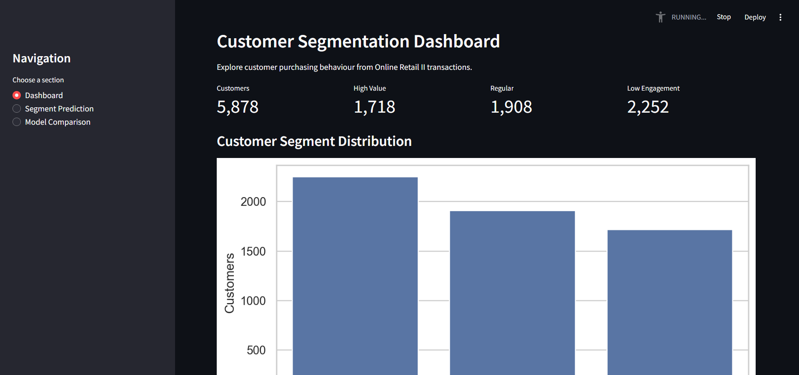
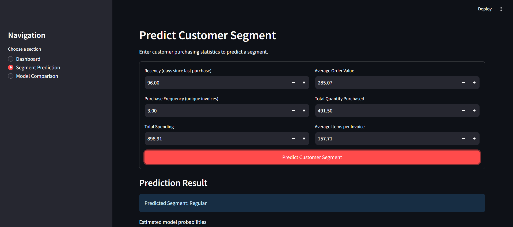
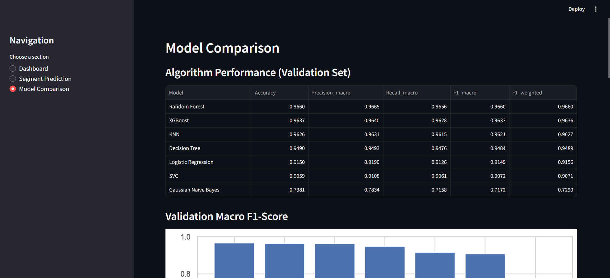
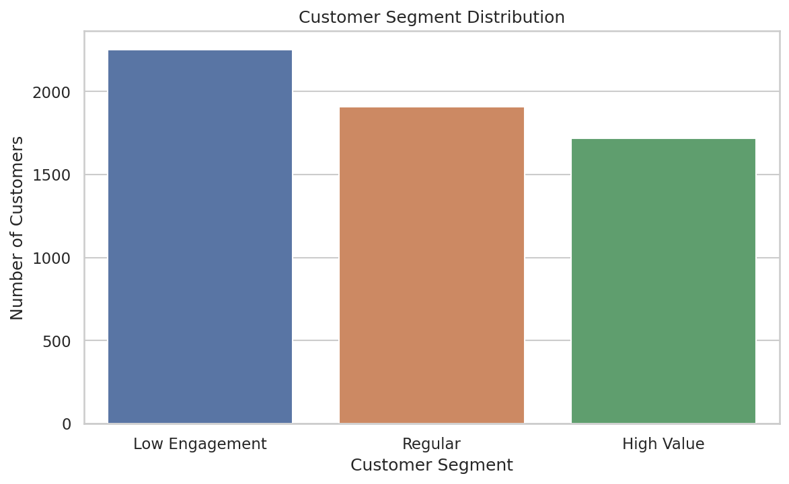
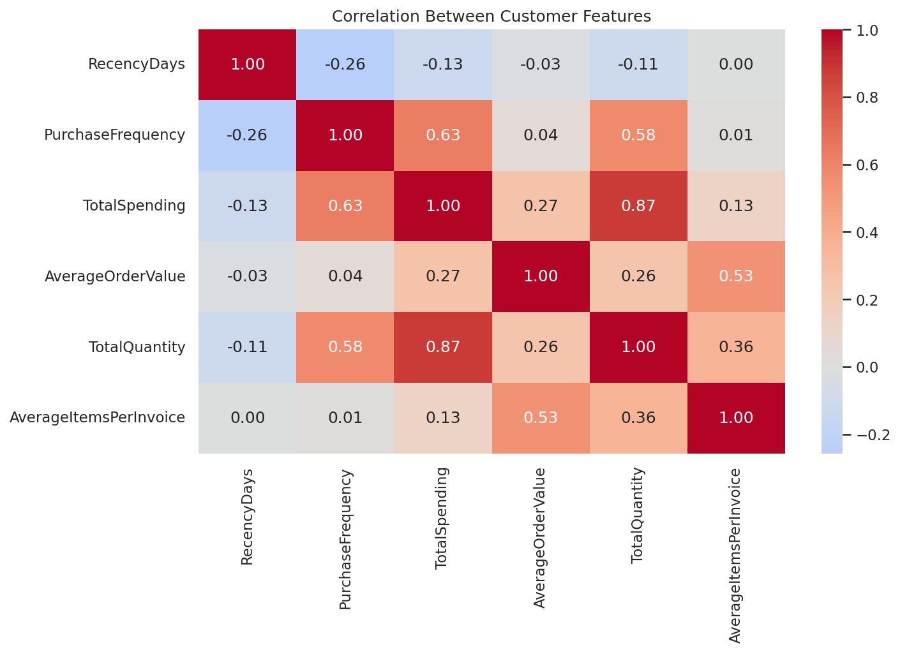
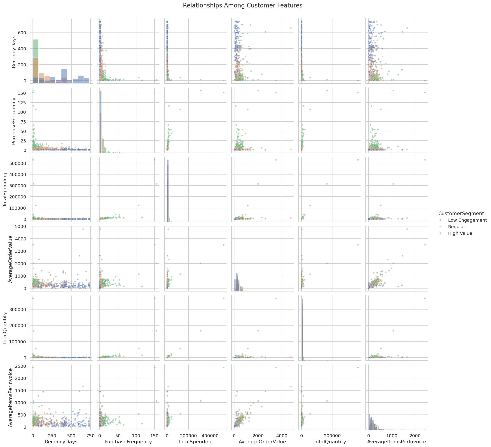
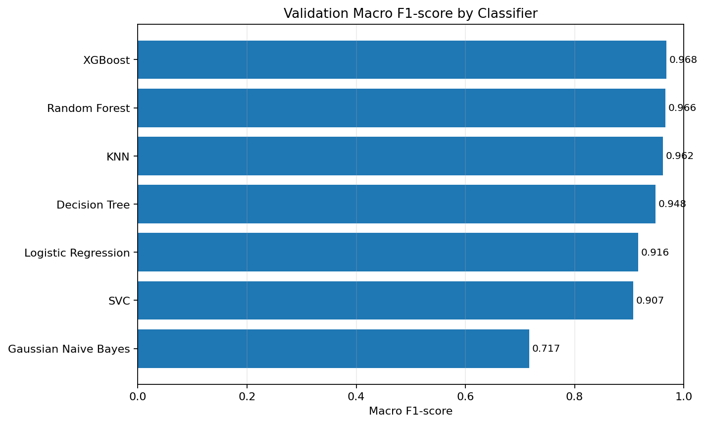

# Customer Segmentation Category Prediction Using Machine Learning

A beginner-friendly, **traditional machine learning classification** project that predicts a customer's segment from their historical purchasing behaviour. It uses the UCI Online Retail II transaction dataset, customer-level feature engineering, seven conventional ML classifiers, and a Streamlit interface.

> **Note:** The screenshots below show the project running in Streamlit. Segment labels are derived from documented RFM-style rules, so the classifier learns to reproduce those labels from customer features. This is an educational demonstration, not a claim that the labels are independently verified customer value categories.

## Dataset

This project uses the Online Retail II dataset from the
UCI Machine Learning Repository.

Download the dataset from the official source:

https://archive.ics.uci.edu/dataset/502/online+retail+ii

After downloading, extract the Excel file and place it inside:

data/online_retail_II.xlsx

The dataset is not included in this repository because of its file size.

## Deployed / Streamlit screenshots

### 1. Dashboard



The dashboard summarizes the number of customers in each segment and visualizes the segment distribution.

### 2. Segment prediction



Enter customer purchasing statistics and click **Predict Customer Segment** to see the predicted category and estimated model probabilities.

### 3. Model comparison



The comparison page presents validation metrics and a macro F1-score chart for the trained classifiers.

## EDA and model graphs

All EDA plots are saved to `results/eda/`; the EDA script does not open pop-up chart windows.

### Customer segment distribution



### Correlation heatmap



### Feature relationships



### Model validation comparison



More saved plots include individual feature distributions, outlier boxplots, and feature comparisons across segments. Browse `results/eda/` to see them.

## Features

- Customer-level features engineered from transaction history.
- Three target classes: **High Value**, **Regular**, and **Low Engagement**.
- Comparison of seven traditional ML classifiers:
  1. Logistic Regression
  2. Decision Tree
  3. Random Forest
  4. Support Vector Classifier (SVC)
  5. K-Nearest Neighbors (KNN)
  6. Gaussian Naive Bayes
  7. XGBoost
- Streamlit interface with three sections: Dashboard, Segment Prediction, and Model Comparison.
- EDA charts saved as image files instead of opening interactive windows.
- Saved model pipeline, model comparison table, test metrics, and predictions.

## Dataset

The project uses **Online Retail II** from the UCI Machine Learning Repository. The original data consists of retail transactions, not pre-labelled customer segments. The project aggregates transaction rows into customer-level features and assigns labels using the RFM-derived rule saved in `results/model_info.json`.

Dataset reference: [UCI Online Retail II](https://archive.ics.uci.edu/dataset/502/online+retail+ii)

The dataset file is expected at:

```text
data/online_retail_ii.xlsx
```

If you are publishing this repository publicly, check the dataset's license/terms and consider keeping the large raw dataset out of GitHub. You can instead provide instructions for placing the dataset locally.

## Customer features

The model uses these six features:

| Feature | Meaning |
|---|---|
| `RecencyDays` | Days since the customer's most recent purchase in the selected observation period |
| `PurchaseFrequency` | Number of distinct invoices/orders |
| `TotalSpending` | Total spending calculated from quantity and unit price |
| `AverageOrderValue` | Average value per invoice |
| `TotalQuantity` | Total quantity purchased |
| `AverageItemsPerInvoice` | Average quantity per invoice |

The segment labels are rule-derived rather than supplied as ground-truth labels by the original dataset. The model's evaluation therefore measures how well it reproduces these engineered labels, not a verified business outcome.

## Project structure

```text
customer_segmentation_ml_project/
├── app.py
├── requirements.txt
├── README.md
├── data/
│   └── online_retail_ii.xlsx
├── notebooks/
│   └── eda.py
├── src/
│   ├── data_utils.py
│   ├── predict.py
│   └── train_model.py
├── models/
│   └── best_model_pipeline.pkl
├── results/
│   ├── customer_features.csv
│   ├── model_comparison.csv
│   ├── model_info.json
│   ├── final_test_metrics.json
│   ├── test_predictions.csv
│   └── eda/
│       ├── customer_segment_distribution.png
│       ├── correlation_heatmap.png
│       ├── feature_relationships.png
│       ├── model_comparison_f1.png
│       └── ... other saved EDA plots
└── screenshots/
    ├── dashboard.png
    ├── segment-prediction.png
    └── model-comparison.png
```

## Algorithms and evaluation

The training script compares seven traditional classifiers. Model comparison metrics are written to `results/model_comparison.csv`. The selected model and label definition are saved in `results/model_info.json`; final test metrics are stored in `results/final_test_metrics.json`.

The current saved validation comparison reports the following macro F1-scores:

| Model | Validation macro F1 |
|---|---:|
| XGBoost | 0.9680 |
| Random Forest | 0.9660 |
| KNN | 0.9621 |
| Decision Tree | 0.9484 |
| Logistic Regression | 0.9161 |
| SVC | 0.9072 |
| Gaussian Naive Bayes | 0.7172 |

These values are from the saved run included with this project. Results can vary if the dataset, feature engineering, split, or dependencies change. Because labels are derived from RFM rules, strong scores do not by themselves demonstrate real-world business usefulness.

## Installation

Python 3.10 or 3.11 is a reasonable starting point.

### Windows (PowerShell or Command Prompt)

```bash
python -m venv .venv
.venv\\Scripts\\activate
python -m pip install --upgrade pip
pip install -r requirements.txt
```

### macOS / Linux

```bash
python3 -m venv .venv
source .venv/bin/activate
python -m pip install --upgrade pip
pip install -r requirements.txt
```

## Run the project

Run commands from the repository root.

### 1. Run exploratory data analysis

```bash
python notebooks/eda.py
```

Charts are saved in `results/eda/`. The script uses a non-interactive Matplotlib backend, so it does not pop up chart windows.

### 2. Train and compare models

```bash
python src/train_model.py
```

This prepares customer-level features, trains and evaluates the classifiers, and updates the saved model and result files. Training may take a few minutes depending on your computer.

### 3. Launch the Streamlit app

```bash
streamlit run app.py
```

Streamlit will print a local URL, usually `http://localhost:8501`, which you can open in your browser.

## Outputs

- `models/best_model_pipeline.pkl` — fitted preprocessing and selected classifier.
- `results/model_comparison.csv` — validation metrics for all classifiers.
- `results/model_info.json` — selected model, features, classes, and label rule.
- `results/final_test_metrics.json` — final test metrics.
- `results/test_predictions.csv` — test-set predictions.
- `results/eda/` — saved EDA charts.

## Limitations

- Customer segments are created from rules; the original transactions do not provide independent segment ground truth.
- Transactions may include cancellations, returns, missing customer IDs, or unusual quantities/prices. Review the data cleaning logic before interpreting business conclusions.
- A customer's segment can change over time; production use would need a defined observation window and careful temporal validation.
- Model probabilities are estimates, not guarantees.
- This is a classroom project, not a production customer relationship management system.

## Tech stack

Python · Pandas · NumPy · Scikit-learn · XGBoost · Matplotlib · Seaborn · Streamlit · Joblib

## License

Add a license file if you intend to make this repository open source. Verify the dataset terms separately before redistributing the raw dataset.
